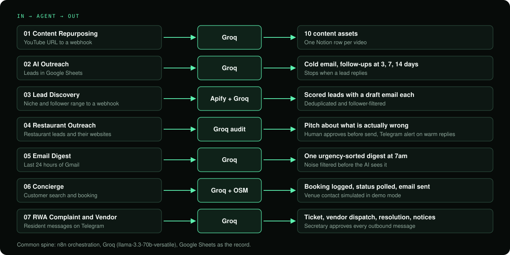

<div align="center">



<br/>


**Eight n8n builds for [Edit Theory](https://github.com/Samhita1008), my AI automation practice for D2C brands and local businesses.**  
Each one documents what it does, how the pipeline runs, and what broke while I built it.

[Portfolio](https://edittheory-portfolio.vercel.app/) · [Concierge demo](https://edit-theory-concierge-s6ra.vercel.app) · [LinkedIn](https://linkedin.com/in/samhita-tavutu-b17b2a37b/)

</div>

---

## At a glance

<div align="center">

</div>

## The agents

| # | Agent | What it does | Workflow file |
|---|---|---|---|
| 1 | [Content Repurposing](./1-content-repurposing) | Turns one YouTube video into 10 content assets and saves them to Notion | [Published](./1-content-repurposing/workflow.json) |
| 2 | [AI Outreach](./2-ai-outreach) | Sends personalized cold emails, follows up on a schedule, tracks replies | [Published](./2-ai-outreach/workflow.json) |
| 3 | [Lead Discovery](./3-lead-scraper) | Finds and scores Instagram leads for a niche and drafts outreach for each | [Published](./3-lead-scraper/workflow.json) |
| 4 | [Restaurant Outreach](./4-restaurant-outreach) | Audits restaurant websites and writes pitches based on what's wrong | [Published](./4-restaurant-outreach/workflow.json) |
| 5 | [Email Digest](./5-email-digest) | Sorts your inbox by urgency and sends a morning summary to Telegram | [Published](./5-email-digest/workflow.json) |
| 6 | [Concierge](./6-edit-theory-concierge) | Booking assistant for local businesses. Backend docs here, [frontend in its own repo](https://github.com/Samhita1008/edit-theory-concierge) | Not published |
| 7 | [RWA Complaint and Vendor Coordination](./7-rwa-society-agent) | Complaints, vendor dispatch, resolution tracking and notices for an apartment society over Telegram, with secretary approval. [Standalone repo](https://github.com/Samhita1008/rwa-complaint-agent) | Not published |
| 8 | [Contract Redlining](./8-contract-redlining-agent) | Reviews contracts clause by clause against a playbook, scores risk, and routes to counsel for approval. Outcome-based fee booked only after sign-off | [Published](./8-contract-redlining-agent/workflow.json) |

> **Start with Concierge.** It is the biggest build here: a customer-facing product with a frontend, not just an internal automation. Parts of it run in demo mode, and its README says exactly which parts.
>
> **For lead follow-up and outreach**, read [AI Outreach](./2-ai-outreach) and [Restaurant Outreach](./4-restaurant-outreach). Both publish a full workflow you can import.

## Why read these

Every agent README has the same shape, so you can skim one and know where to look in the rest:

1. **What it does.** Plain language, no buzzwords.
2. **Pipeline.** The node-by-node flow.
3. **Stack.** What it runs on.
4. **Engineering notes.** The real bugs, why they happened, and the fix. This is the part worth reading.

## Run one yourself

Agents 1, 2, 3, 4, 5 and 8 include a `workflow.json`. All keys and personal IDs are replaced with placeholders.

1. In n8n, create a new workflow, open the menu, and choose **Import from file**.
2. Search the workflow for `YOUR_` and replace each placeholder with your own value (listed in each agent's README).
3. Re-select the credentials on any Gmail, Google Sheets, Notion or Telegram nodes.
4. Run it once manually and check each node's output before activating it.

Never commit real API keys to a repo. If you export your own workflow, search the JSON for keys and IDs first.

## Not published

Agents 6 and 7 (Concierge and the RWA agent) are kept private for now. Their READMEs still cover the design and the problems I solved. If you want a walkthrough, email me.

## Repo layout

```
edit-theory-agents/
├── assets/                   banner and overview diagram
├── 1-content-repurposing/    README + workflow.json
├── 2-ai-outreach/            README + workflow.json
├── 3-lead-scraper/           README + workflow.json
├── 4-restaurant-outreach/    README + workflow.json
├── 5-email-digest/           README + workflow.json
├── 6-edit-theory-concierge/  README
├── 7-rwa-society-agent/      README
└── 8-contract-redlining-agent/ README + workflow.json
```

## Stack

n8n · Groq (Llama 3.3 70B) · Anthropic (Claude) · Gmail · Google Sheets · Telegram · Notion · Apify · Supadata

---

<div align="center">

Built by **Samhita** · [samhitatavutu@gmail.com](mailto:samhitatavutu@gmail.com)

</div>
